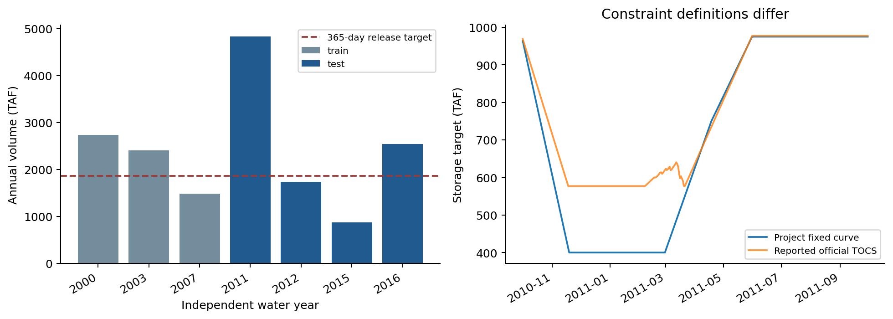
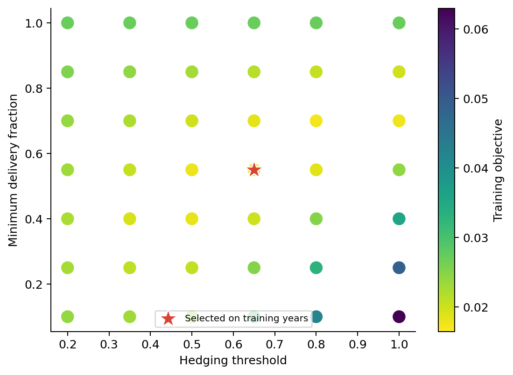
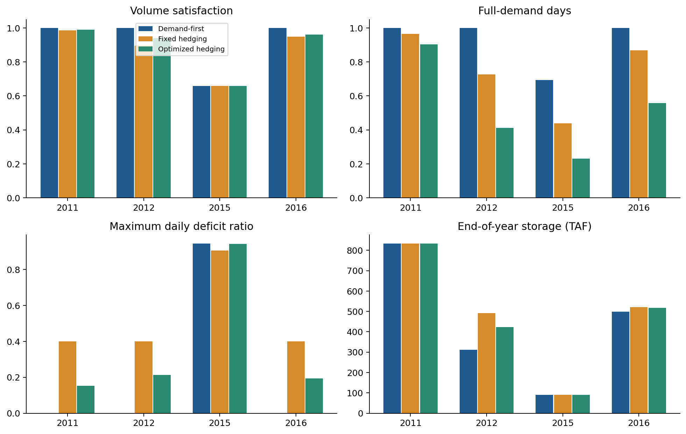
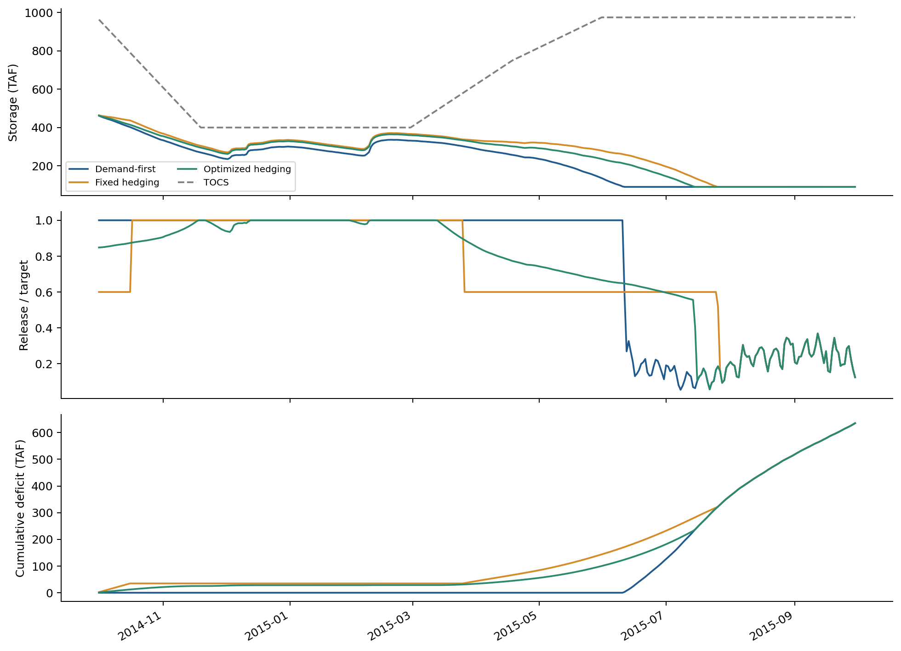
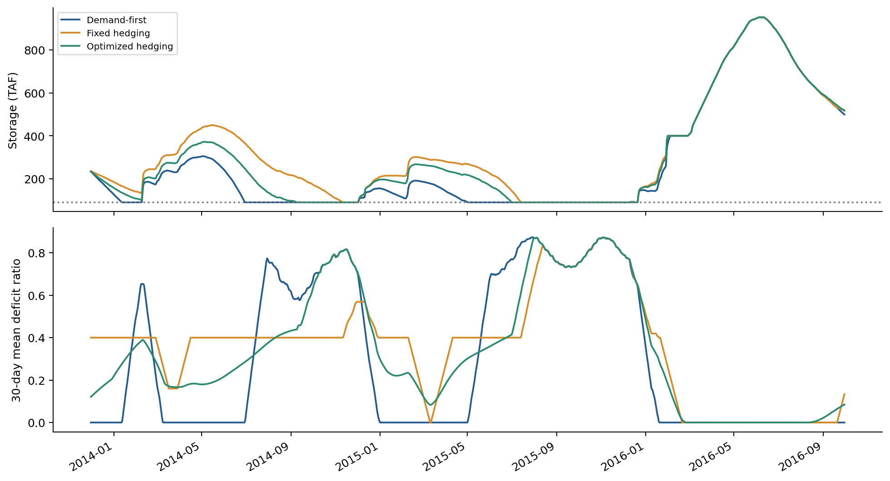
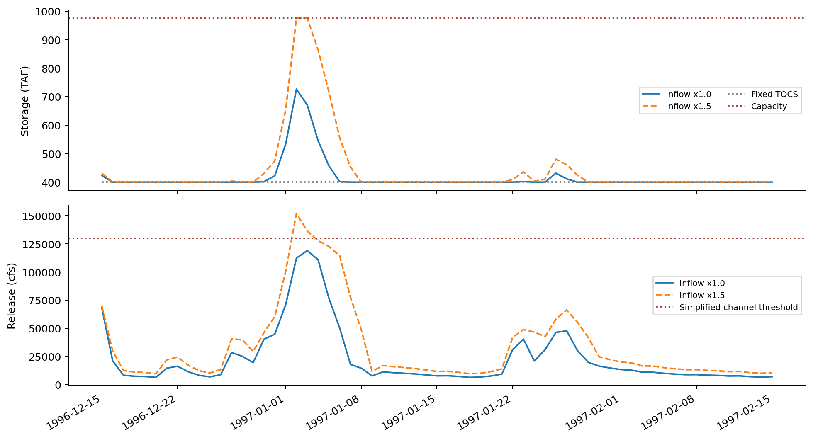
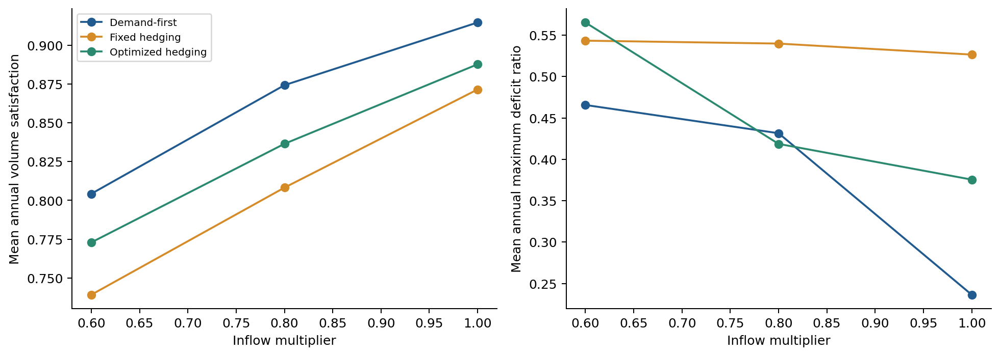
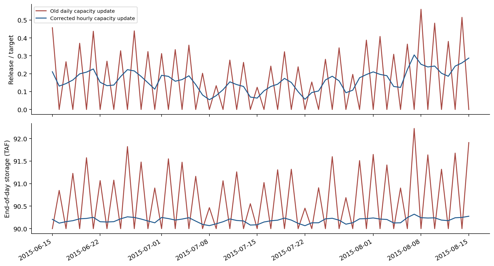

# Folsom水库供水保障与防洪约束下的调度策略比较
## 基于官方水文输入与情景需水的可复现研究

研究日期：2026-10-22。版本：数值时间步长修正版。研究性质：课程尺度的真实案例情景试验。研究对象为美国加州Folsom水库；本文不声称复现其真实历史管理，也不提出可直接投入工程运行的调度规程。原版低库容隔日振荡及相关统计已更正，以本版为准。

## 摘要

水库供水、防洪和生态保障之间存在取舍。本研究先审查公开项目数据，再以加州CDEC官方日入流和计算蒸发为驱动，选取七个字段完整、标记合格的完整水文年，建立带库容、出库能力、季节控制库容与最低下泄代理的日水量平衡模型。比较按需求供给A、固定分级限水B和网格优化连续限水C。仅使用2000、2003、2007年选择C的参数，2011、2012、2015、2016年用于独立检验，并补充连续枯水、历史洪水与参数敏感性分析。

四个检验年份等权平均的目标下泄体积满足率：A为91.47%，B为87.15%，C为88.77%。C的相对缺水平方均值较A降低10.31%，但完全满足日比例由92.33%降为52.60%。在连续1036天枯水窗口中，B的缺水平方指标又优于C。1997年洪水窗口中三策略结果一致，说明共用防洪约束主导洪水期运行；放大入流会暴露溢流和下游安全阈值超出。

结果不支持“优化限水在所有条件下更好”。常规条件下A效率更高；有明确减轻严重缺水偏好时可考虑B或C，但应接受更多限水日及较低总体满足率。真实需水、用户分配和水温资料不足，限制了经济、公平及生态结论。

## 1 研究问题、系统边界与现实意义

Folsom承担防洪、供水、发电及其他功能，其运行涉及USBR、USACE、地方水务机构、下游居民和生态利益相关者。[1][2] 本文研究的问题是：在相同水文输入和运行边界下，提前限水能否减轻严重缺水；这种收益需要付出多少供给效率与限制持续时间的代价；强洪水时是否仍存在不可满足的控制目标。

系统边界为Folsom单库及一个汇总下游目标，不显式模拟Nimbus调节、上游水库、管网、支流、取水与河道洪水演进。总下泄只能作为供给和生态目标的代理，不能直接等同于用户消耗水或下游河段实际流量。

| 利益相关者 | 关注目标 | 在本研究中的表达与限制 |
| --- | --- | --- |
| 水库与水资源管理者 | 供给、储备、运行可行性 | 目标满足率、年末储备、出库约束 |
| 防洪管理及下游居民 | 防洪空间及下泄风险 | 控制库容超出和简化下泄阈值，非淹没损失 |
| 城乡及农业用户 | 可用水量与限水负担 | 只有汇总目标，无法分别计算群体效益 |
| 生态管理者及河流生态 | 流量、冷水、水温和栖息地 | 仅最低流量与低库容代理，未模拟水温和生物响应 |

## 2 数据审查与研究样本

### 2.1 数据来源和清洗

官方数据来自CDEC FOL站，原下载范围为1994-01-01至2016-09-30。[3] 传感器15、76、23、74、94分别对应蓄水、入流、出流、计算蒸发和防洪控制库容。原始AF除以1000转为TAF；日均CFS乘以86.4/43560转为TAF/day。1 TAF约为123.348万m³。所有原始文件、下载地址和哈希均保留。

前期GitHub长序列虽在1955年后没有数值空缺，仍含疑似入流下限处理及较大水量平衡偏差。因此本文没有把“无空值”当作有效性证明，也没有用该序列填补官方缺测。[4] CDEC全量表同样保留缺失、来源标记和OBS DATE差异，详细见配套数据清洗报告。

本试验的外生驱动只有入流与蒸发。入选水文年要求二者每日完整、非负、来源标记为空且无跨日观测时间问题；其他字段缺测不影响其作为驱动年份，但不能据此声称这些年份的官方防洪约束已完整。2002年虽驱动数值齐全，但存在来源标记，未纳入参数选择。没有插值、负值截零或非相邻时段拼接。

| 水文年 | 用途 | 年入流/TAF | 天数 |
| --- | --- | --- | --- |
| 2000 | 参数选择 | 2731.04 | 366 |
| 2003 | 参数选择 | 2401.87 | 365 |
| 2007 | 参数选择 | 1484.66 | 365 |
| 2011 | 独立检验 | 4831.60 | 365 |
| 2012 | 独立检验 | 1740.02 | 366 |
| 2015 | 独立检验 | 869.25 | 365 |
| 2016 | 独立检验 | 2536.91 | 366 |

七个独立年合计2558天，水文年为上一年10月1日至当年9月30日。样本按数据可用性选择，不是随机抽样，不能用其频率估计长期事件概率。各独立年均从466.1 TAF开始，属于共同初始条件，而非逐年真实初始状态。为检验这一设定的局限，另分析初始250、700 TAF及连续跨年窗口。

### 2.2 需水和约束的证据等级

需水采用公开项目demand.txt前365项，最后一项是第一项的重复端点，未重复计入年总量。[4] 365日合计1861.043 TAF。按月日映射；2月29日取2月28日与3月1日均值。该曲线表示汇总有益下泄目标，不是经核实的实际逐年需水。

库容上限975 TAF、保留库容90 TAF、出库能力曲线和季节控制曲线来自项目配置，属于明确的模型设定。[4] 官方背景资料中的容量数值随资料和时期有所区别；本文另以977 TAF检查敏感性，不擅自将975 TAF设定称为现行官方容量。[1][2]

2011水文年的五项官方字段均通过前期筛查，日平衡残差最大约0.001215 TAF。它用于单位核查以及将简化控制曲线替换为官方报告TOCS的敏感性分析。后者是约束回放，不是可预报运行策略；官方TOCS可能包含当时预测与上游信息。

图1中2015年入流最小、2011年最大，仅表示本样本内排序。右图说明项目冬季400 TAF控制库容与2011官方报告的约577 TAF等控制库容存在明显区别；不能把固定简化曲线当作真实逐日规程。

## 3 可计算模型

### 3.1 状态、决策与水量平衡

每日状态为日初库容S，输入为日入流Q、蒸发E、汇总目标D、最低流量代理F和控制库容T。决策为目标下泄u，经物理限制后得到控制下泄r与非控制溢流w。

`S_end = S_begin + Q - E - r - w`

定义日可用水量A = S_begin + Q - E，主动腾库需求f = max(A - T, 0)。控制出库能力C(S_begin)由下列点线性插值得到，单位为cfs，并换为日水量：

| 库容/TAF | 90 | 100 | 400 | 600 | 975 |
| --- | --- | --- | --- | --- | --- |
| 控制出库能力/cfs | 0 | 35000 | 40000 | 115000 | 130000 |

为避免低水位出库能力随库容急变时的日步长振荡，每日分成24个内部子步，dt=1/24天，日入流、蒸发率和目标在日内均匀分配，出库能力随子步库容更新。这是数值积分，不是获得了实际小时观测数据。子步计算为：

`A_k = S_k + (Q - E)*dt`

`f_k = max(A_k - T, 0)`

`r_k = min(max(u*dt, f_k), C(S_k)*dt, max(A_k - 90, 0))`

`w_k = max(A_k - r_k - 975, 0)`

`S_(k+1) = A_k - r_k - w_k`

将子步下泄和溢流加总得到每日r、w；上式C已从cfs换算为TAF/day，子步r_k、w_k为TAF。总量守恒与出库能力约束仍逐子步、逐日检查。

控制能力不足时，日末库容可能超过T；该情况作为控制目标未满足报告，不强制伪造可行性。超过物理上限的水通过w计入非控制溢流；若r+w超过130000 cfs对应日水量，则记录安全阈值超出。这个处理维持模型水量平衡，不证明真实溢洪道过程或下游行洪安全。

所有策略共用相同的T、控制能力、容量和低库容约束。日内Q在计算下泄时视为可得，同日信息条件对全部策略一致；没有使用未来日入流优化。真实运行仍需预报误差、小时过程与水力模型。

### 3.2 控制曲线与生态代理

固定控制曲线按水文年日序线性插值：(0,975)、(50,400)、(151,400)、(200,750)、(243,975)、(366,975)，单位TAF。[4] 闰日保留，因此与原项目删除闰日的做法有一个日序差异，属于本文声明的时间约定。

生态流量代理采用手册引用的D-893历史低流量线：1月1日至9月14日250 cfs，9月15日至12月31日500 cfs。[2] 这些要求针对Nimbus以下河段，且手册说明较新的生态要求通常更复杂、更高。本文只将它作为简化筛查基线，不能据此宣称满足当时或现行生态法规。

最低代理通过u = max(策略目标, F)施加；它与有益下泄由同一股出流服务，没有额外重复扣水。对应目标满足量Y = min(D, r+w)。这隐含同日出流可用于目标的假设，未考虑输配能力；因此所有“供给满足率”在本文均指目标下泄满足率。

### 3.3 三种管理策略

策略A：u = max(D,F)。优先满足当日目标，有水且能力允许时不主动限制。

策略B：定义相对有效库容z = clip((S_begin-90)/(T-90), 0, 1)。z低于0.5时给出0.6D，否则D；再与F取最大值。0.6是指令比例，物理缺水时不保证实际达到60%。

策略C：目标比例a = alpha + (1-alpha) min(1, z/theta)，再取u = max(aD,F)。这是一种连续限水规则，接受较轻的当前缺口以降低后续较严重缺口的可能性，符合hedging的基本思想。[5] 本文规则及参数搜索范围是自行声明的简化实现，不直接照搬文献最优结论。

### 3.4 参数选择与独立检验

theta候选为0.2、0.35、0.5、0.65、0.8、1.0；alpha候选为0.1、0.25、0.4、0.55、0.7、0.85、1.0，共42组。目标函数为训练年原入流与80%入流共六个情景等权平均：

`J = mean( mean_daily((deficit/D)^2) + 0.05*(max(300-S_end,0)/300)^2 )`

平方缺水惩罚表达对严重缺口的厌恶；300 TAF和0.05是储备偏好，不是法律底线或经济价值。网格内选中theta=0.65、alpha=0.55，训练目标J=0.016472。随后冻结参数，不用检验年份重新选择。结果只称为给定规则与网格内的参数优化，不称为全球最优调度。

## 4 评价指标

体积满足率为1-sum(deficit)/sum(D)；完全满足日比例要求日缺口不超过1e-7 TAF。相对缺水平方均值为日(deficit/D)平方的均值，最大日缺水率和最长连续缺水天数分别衡量严重程度与持续性。恢复率为缺水日向满足日转移次数除以存在次日的缺水日数；无缺水时记为不适用，不填0。可靠性、恢复和脆弱性分开评价的思想参考Hashimoto等。[6]

为避免严格完全满足指标放大小限制的影响，另报告至少满足95%和90%目标的日比例。跨独立年份不计算边界状态转移，四个检验年份按年等权汇总，不将四年视为连续运行。

生态代理不足日数与低库容天数仅是流量及储备筛查。公平方面，记录供给低于50%汇总目标的天数，作为假设性基本保障暴露；这一指标不代表真实贫困群体、农业和城镇之间的分配公平。没有实际价格、用户损失和工程投资数据，故不计算虚构的净经济收益。

## 5 独立检验结果

### 5.1 总体取舍

| 策略 | 体积满足率 | 完全满足日比例 | 相对缺水平方均值 | 平均年末库容/TAF |
| --- | --- | --- | --- | --- |
| A 按需求供给 | 91.47% | 92.33% | 0.04872 | 433.67 |
| B 固定分级限水 | 87.15% | 74.96% | 0.05934 | 484.16 |
| C 参数优化连续限水 | 88.77% | 52.60% | 0.04370 | 465.84 |

上述为四年等权平均，不是长期保证率或概率估计。C相对A降低缺水平方约10.31%，但体积满足率降低2.69个百分点，完全满足日比例降低39.72个百分点；平均年末库容提高32.17 TAF。B储备更高，但其平均缺水平方反而高于A和C。没有一个策略在全部指标上占优。

| 策略 | 完全满足 | 至少满足95%目标 | 至少满足90%目标 |
| --- | --- | --- | --- |
| A | 92.33% | 92.33% | 92.33% |
| B | 74.96% | 74.96% | 74.96% |
| C | 52.60% | 59.92% | 70.79% |

改变满足阈值有助于区分轻度限制与实质缺水，但不能把C较低的完全满足比例直接解释为模型失败，也不能因平方指标下降就忽略用户经历更多限制。

### 5.2 分年度结果与2015年

| 水文年 | 策略 | 体积满足率 | 最大日缺水率 | 最长连续缺水/天 |
| --- | --- | --- | --- | --- |
| 2011 | A | 100.00% | 0.00% | 0 |
| 2011 | B | 98.48% | 40.00% | 13 |
| 2011 | C | 99.02% | 15.19% | 35 |
| 2012 | A | 100.00% | 0.00% | 0 |
| 2012 | B | 89.44% | 40.00% | 50 |
| 2012 | C | 94.03% | 21.34% | 101 |
| 2015 | A | 65.87% | 94.55% | 112 |
| 2015 | B | 65.87% | 90.64% | 189 |
| 2015 | C | 65.87% | 94.30% | 202 |
| 2016 | A | 100.00% | 0.00% | 0 |
| 2016 | B | 94.82% | 40.00% | 19 |
| 2016 | C | 96.17% | 19.37% | 111 |

2011、2012、2016年，A完全满足情景目标，而B、C产生主动限制。2015年严重枯水，三策略体积满足率均约65.87%，最大日缺水率A、B、C分别为94.55%、90.64%、94.30%。修正数值步长后不再出现原版的隔日零下泄，但物理短缺依然存在，提前限水没有创造新水。

2015年缺水平方：A为0.19488、B为0.16697、C为0.16097。A低于50%目标的天数为111，C为78；生态代理不足日数从6降为5。C最长连续缺水为202天，高于A的112天。C将更集中、较重的短缺部分分摊为更长时间的限制，不是全面改善。

## 6 跨年与洪水补充检验

### 6.1 跨年携带效应

连续2009-12-16至2013-05-11共1243天的可用驱动窗口中，A体积满足率为100.00%，B为97.55%，C为98.38%。C在此情形下仍会带来不必要的目标限制，因此不能仅凭低库容比例机械地全年采用同一限水规则。

另取2013-11-30至2016-09-30连续1036天，沿用前一日官方库容237.3 TAF作为共同初值，保持冻结参数并连续运行。该窗口与检验年份重叠，只是跨年稳健性检查，不是新增独立验证样本。

| 策略 | 体积满足率 | 缺水平方均值 | 低于50%目标/天 | 生态代理不足/天 | 最长缺水/天 |
| --- | --- | --- | --- | --- | --- |
| A | 65.31% | 0.22730 | 396 | 84 | 235 |
| B | 63.94% | 0.19059 | 172 | 56 | 329 |
| C | 64.26% | 0.19354 | 242 | 83 | 791 |

连续枯水中，B缺水平方最低、50%基本目标与生态代理暴露也更少；C相对A仍缓和严重短缺，但最长连续缺水达到791天。这说明逐独立年选择的参数未必适合持续多年干旱，且轻微限水也会延长连续缺水指标。不能将C的单年平均优势直接推广到跨年情形。

### 6.2 洪水窗口与约束失效

选择1996-12-15至1997-02-15共63天完整官方驱动，初值采用前一日官方库容535.559 TAF；1997-01-02日入流约416.251 TAF。该事件在初次基准试验后加入，参数不重新训练，作为明确标注的事后压力检查。

在相同防洪规则下A、B、C结果相同，下表以A代表；入流放大1.25和1.5倍仅为压力情景，不是概率预报或气候变化预测。

| 入流倍率 | 策略 | 最大控制库容超出/TAF | 溢流总量/TAF | 下泄超阈值/天 |
| --- | --- | --- | --- | --- |
| 1.00 | A | 326.26 | 0.00 | 0 |
| 1.25 | A | 472.35 | 0.00 | 0 |
| 1.50 | A | 575.00 | 67.69 | 2 |

原事件无物理溢流或下泄阈值超出，但季节控制库容仍有12天未满足，最大超出326.26 TAF。原因为出库能力限制，而非水量平衡错误；没有将其隐藏为“防洪约束全部满足”。放大情景出现更严重超出，1.5倍情景还触发溢流及下泄阈值超出。因未模拟河道演进，不能把该结果换算成下游淹没概率或洪灾经济损失。另输出子步峰值，但它来自日均水量均匀分配的数值模型，不能解释为实际小时洪峰。

## 7 关键假设和参数敏感性

| 情景 | A体积满足率 | B体积满足率 | C体积满足率 | C缺水平方均值 |
| --- | --- | --- | --- | --- |
| 入流80% | 87.43% | 80.82% | 83.65% | 0.06708 |
| 入流60% | 80.43% | 73.92% | 77.29% | 0.10283 |
| 需水120% | 86.90% | 80.23% | 83.03% | 0.07050 |
| 需水80% | 94.55% | 92.59% | 93.38% | 0.02003 |
| 初始250TAF | 84.84% | 78.78% | 80.85% | 0.07892 |
| 初始700TAF | 92.33% | 90.27% | 91.27% | 0.03806 |
| 控制曲线+177TAF | 91.47% | 85.60% | 87.56% | 0.04359 |

检验参数保持不变。入流缩减、需求增加或初始库容降低都使目标满足率恶化。C对严重缺水的平方惩罚在若干压力情景中较低，但在体积满足率上仍低于A；最大日缺水率并非其优化目标，可能更差。因此不能只展示一个对C有利的指标。

容量从975增加至977 TAF在当前样本和规则下没有产生可见改善，说明微小容量修正不是本试验结论的主要驱动；不等于真实扩容没有价值。控制曲线上移会改变可保留水量，但也改变相对库容z，从而改变主动限水频次，效果不能仅解释成“放宽防洪必然增加供水”。

2011年替换为官方报告TOCS后，A仍完全满足目标，C满足率约98.47%，三者均无控制库容超出；该结果验证了简化固定曲线选择的影响，不足以证明其他年份运行安全。

把生态代理设为零或双倍，在本组检验情景下没有改变供给结果，因为主动目标通常高于代理，极低库容时又受到可用水和能力限制。生态不足指标本身仍会随代理改变，不能据此推断“生态要求对调度没有影响”。

储备权重由0.05改为0时，选中theta=0.80、alpha=0.70；提高到0.2后alpha变为0.40。更重的储备偏好增加提前限制，在2015年降低缺水平方，却损失其他年份的满足率，说明所谓最优取决于管理偏好。

## 8 管理建议及适用条件

第一，不能将参数优化C直接替代常规管理。以目标下泄量和完全满足为主要目标时，A在检验样本中更有优势。若管理部门愿意以较频繁、较轻的限制换取部分严重短缺缓和，可以把C作为候选，并明确发布限制阈值和退出条件。

第二，持续多年枯水应单独制定管理制度。1036天窗口中B优于C的部分风险指标，提示需要考虑跨年储备、关键用户保障和限制持续时间。本研究未检验“正常年用A、干旱年切换B/C”的完整切换算法，故该安排只是实施方向，不附会未计算的收益。

第三，防洪约束应具有更高的实时执行优先级。大洪水中三种供给策略没有明显差别，改动限水参数不能解决出库能力和河道容量限制。工程采用前需接入实际水控手册、上游调度、小时级洪水预报及河道演进模型，不得把本研究的130000 cfs简化阈值当作无条件安全承诺。

第四，制度上应先明确基本用水、生态与其他用途的权利和损失承担。当前数据只能显示汇总短缺如何在时间上分布，不能判断真实群体公平。实际实施应补充部门需水、供水位置、合同优先级、价格与补偿资料；限水公告、透明触发条件、用户反馈及补偿机制是必要管理组成。

第五，生态评价需要由最低流量代理扩展到冷水储备、水温和生境，防止将“低流量线达标”误认为生态无损害。[2][7] 本研究保留生态不足和低库容指标，但不据其推算鱼类数量或水质改善。

## 9 局限与可推广程度

一是需水与部分运行参数为项目情景，不能解释真实历史效益。二是七个年份经过完整性筛选，严重事件覆盖与长期统计代表性有限。三是独立年共同初值切断前期影响，已用连续窗口补充，但仍未构成长时段完整历史重建。四是没有未来预测误差、日内洪峰、上游水库、支流、输配和取水，日模型不能用作实时防洪。五是出库曲线、容量和保留库容未按年代变化，90 TAF保留库容与出库能力的组合会导致低水位供给受限，应作为模型结构不确定性理解。六是汇总目标与下泄重合假设可能高估真实用户可用水，公平及经济评价只可讨论，不能量化货币利益。七是网格有限、训练年较少、目标权重主观，禁止将候选参数称为普适最优。

## 10 结论

本研究以可追溯官方输入完成了清洗、建模、三方案比较、独立年份检验、跨年与洪水窗口检查及敏感性分析。核心发现是供给效率、缺水严重程度、限制持续时间和储备之间的取舍。C在独立年份平均缺水平方上较A低10.31%，同时减少目标满足量并增加限制日；跨年枯水中B在若干风险指标上又优于C。防洪边界在极端情景下可能不可同时满足，应如实报告，而不是宣称所有方案安全。

最终建议是按管理偏好和干旱持续性选择候选策略，保留A作为效率基线，审慎使用提前限水；任何工程应用均须先补齐真实需水、调度规程和下游模型。本结论适用于本文模型、样本与情景范围。

## 11 可复现性与计算检查

入口脚本为scripts/run_folsom_research.py，无需大模型或付费API。它读取清洗后的官方表及独立需水情景，输出42组训练目标、21条年度方案结果、132条敏感性方案结果、偏好敏感性、两段连续窗口、官方TOCS回放、9条洪水事件方案及逐日结果。所有图均提供PNG与独立PDF。

模型内部检查逐日平衡、非负与容量边界、控制出库能力，验证alpha=1时C退化为A、无水时守恒、极端入流时显式报告溢流，以及控制曲线超出仅在出库能力绑定时发生。当前共有22项检查通过；这些检查证明数值实现满足所声明规则，不证明真实世界参数或管理结论已得到现场验证。落盘结果另进行独立重算校核。

## 12 图表异常的原因、修正与数值收敛

原版2015年下泄比例图出现大量隔日归零尖峰。逐日核查表明：同一时段官方入流保持为正，缺测、来源标记和跨日时间也未出现对应异常；问题主要来自模型实现，而非这段入流数据的隔日异常。原算法在日初库容90 TAF时将全天出库能力锁定为0，当天积水，次日再集中放水，因而产生人工隔日振荡。原版只有水量守恒和边界检查，不能排除这种数值伪影。

在90-100 TAF线性出库区间，能力变化斜率约为6.94/天；按局部线性化，显式更新因子为1-6.94*dt。日步长下该因子约-5.94，结合边界裁切形成振荡；dt=1/24时约0.71。此次改为日内24子步并及时更新出库能力，保留原始日水文数据，没有对结果做移动平均，没有隐藏真实日波动。

已比较每日1、4、12、24、48、96子步。2015年三策略24与96子步的体积满足率差小于0.000001、缺水平方差小于0.00001，均通过预设检查；细化后隔日零下泄消失。这里是该低库容案例的步长收敛证据，不等于对全部真实水力过程的验证。

图8用于解释修正，正式结果图4采用重新计算的24子步输出，可以保留。原版相关统计已整体重算，不能再沿用原报告12.33%的缺水平方改善值，应以本版摘要及结果表为准。

## 参考资料

[1] Bureau of Reclamation. Central Valley Project. https://www.usbr.gov/mp/cvp/ （官方背景；访问2026-10-22）。

[2] USACE. Folsom Dam and Lake Water Control Manual, June 2019. https://water.usace.army.mil/cda/documents/wc/3098/Folsom2019WCManual%5BR%5D.pdf （历史与运行背景、D-893说明；并非本文全部参数的逐项验证）。

[3] California DWR, CDEC. FOLSOM LAKE (FOL), station metadata and daily sensors. https://cdec.water.ca.gov/dynamicapp/staMeta?station_id=FOL （下载地址及SHA256见docs/cdec_download.json）。

[4] EILab-Polimi / ResLLM. Public data and configuration repository. https://github.com/EILab-Polimi/ResLLM （需水、简化配置与原项目背景；输入数据文件哈希保留）。

[5] You, J., Cai, X. (2008). Hedging rule for reservoir operations: 1. A theoretical analysis. Water Resources Research. https://doi.org/10.1029/2006WR005481

[6] Hashimoto, T., Stedinger, J. R., Loucks, D. P. (1982). Reliability, resiliency, and vulnerability criteria for water resource system performance evaluation. Water Resources Research, 18(1), 14-20. https://doi.org/10.1029/WR018i001p00014

[7] Sacramento Water Forum. Flows and Operations. https://waterforum.org/flows-and-operations/ （流量与冷水储备目标的管理背景）。

## 13 代码、数据与结果的GitHub存档

本研究代码文件、整理数据、逐日模拟结果、方案汇总、敏感性分析及图表存放于公开GitHub项目库：https://github.com/like0009876/folsom-reservoir-study 。代码见scripts/，数据见data/，结果见results/research/，图表见figures/research/，Word及研究报告见report/。仓库README提供项目说明、运行顺序和数值修正摘要。历史错误版本仅作本地审计保留，不作为本次发布的研究结果。

